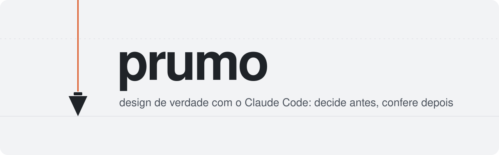

<p align="center">
  <picture>
    <source media="(prefers-color-scheme: dark)" srcset="assets/banner-escuro.svg">
    
  </picture>
</p>

<p align="center">
  <b>Uma skill para o Claude Code criar o design do seu projeto do começo ao fim,</b><br>
  da entrevista ao logo, do design system à última tela, conferindo tudo antes de dizer "pronto".
</p>

---

**Prumo** é o fio com um peso na ponta que o pedreiro usa para saber se a parede está reta. Este kit faz o mesmo
com o design dos seus projetos: o Claude **decide antes de construir** (direção, cores, tipografia, logo) e
**confere antes de entregar** (captura a tela no celular e no computador, critica, corrige).

O resultado é um design com cara de projeto seu, não de template gerado por IA.

## O que ele faz por você

| Você pede | O Prumo conduz |
|---|---|
| "Cria o design do meu projeto" | Entrevista, pesquisa de tendências, 3 direções para você escolher |
| "Preciso de um logo" | Plataforma da marca, esboços, vetor de verdade, testes em 16 px |
| "Monta o design system" | Tokens de cor, tipo e espaço, componentes com todos os estados, página-vitrine |
| "Deixa essa tela mais bonita" | Captura, crítica com checklist, correção, antes e depois |
| "Tá com cara de IA" | Auditoria contra uma lista datada de clichês, com o que fazer no lugar |

## Começar em 3 passos

**1. Copie a skill** para a pasta de skills do Claude Code (vale para todos os seus projetos). De dentro da pasta
deste repositório:

```bash
mkdir -p ~/.claude/skills && cp -r skills/prumo ~/.claude/skills/
```

<details>
<summary>No Windows (PowerShell)</summary>

```powershell
New-Item -ItemType Directory -Force "$HOME\.claude\skills" | Out-Null
Copy-Item -Recurse skills\prumo "$HOME\.claude\skills\"
```

</details>

**2. Instale o Playwright no seu projeto**, para o Claude conseguir ver as telas que ele cria:

```bash
npm i -D playwright
npx playwright install chromium
```

**3. Abra o Claude Code no projeto e diga:**

```text
Use a skill prumo e vamos criar o design deste projeto do zero.
```

Pronto. Ele começa pela entrevista e conduz o resto.

> [!TIP]
> Confira se a skill foi reconhecida digitando `/skills` no Claude Code. Para usar o Prumo em um projeto só,
> copie a pasta para `.claude/skills/` dentro dele em vez de `~/.claude/skills/`.

## A jornada

> **Decidir:** Entrevista → Referências e tendências → Direção → Identidade e logo
>
> **Construir e conferir:** Design system → Telas → Movimento → Captura e crítica → Polimento → Entrega

| Etapa | O que acontece | Você decide |
|---|---|---|
| **Entrevista** | O Claude pergunta sobre o assunto, o público, o objetivo, gostos e recusas | Claro, escuro ou os dois |
| **Referências e tendências** | Pesquisa referências e as tendências do ano, classificadas em seguir, adaptar e evitar | Qual tendência entra |
| **Direção** | Três caminhos visuais bem diferentes, lado a lado, com uma recomendação | Qual caminho seguir |
| **Identidade e logo** | Voz da marca, esboços de logo, vetor final testado em tamanho pequeno | Qual logo |
| **Design system** | Tokens, tipografia, componentes e uma página-vitrine com tudo | Aprovar a vitrine |
| **Telas** | As telas do projeto com conteúdo real; variações quando houver dúvida | Qual variação |
| **Movimento** | Só o que explica uma mudança ou responde a um clique | — |
| **Captura e crítica** | Fotos da tela no celular, tablet e computador; até 5 correções por rodada | — |
| **Polimento e QA** | Detalhes finos, acessibilidade, contraste, código de saída de cada teste | — |
| **Entrega** | DESIGN.md e tokens em dia, capturas de antes e depois | — |

Já tem marca? Ele pula o logo. Já tem projeto pronto? Ele começa lendo o que existe e preserva o que você já
escolheu.

## Claro, escuro ou os dois

O Prumo não impõe tema. Na entrevista você escolhe, e se não souber ele recomenda pelo uso do projeto:

| Escolha | Combina com |
|---|---|
| **Só claro** | Leitura longa, site institucional, loja, público amplo. É o mais simples de manter |
| **Só escuro** | Ferramenta de uso noturno ou contínuo, mídia, conteúdo de foto e vídeo |
| **Os dois** | App de uso diário em horários variados. Segue o tema do sistema e pode ter um seletor |

Daí em diante, cores, contraste e capturas cobrem só o que você escolheu. O modelo de tokens já vem pronto para os
três casos.

## Seu primeiro projeto, conversa por conversa

Você pode só conversar. Se preferir um roteiro, estes são os pedidos na ordem (todos os prompts completos estão em
[`referencias/prompts.md`](skills/prumo/referencias/prompts.md)):

1. **"Use a skill prumo e me entreviste para criar o design deste projeto."**
   Ele monta o brief em 7 linhas, incluindo a escolha do tema.
2. **"Pesquisa as tendências de design deste ano e me diz o que seguir e o que evitar."**
3. **"Me mostra 3 direções visuais diferentes, lado a lado, e recomenda uma."**
   Você escolhe. Pode pedir para misturar.
4. **"Agora cria a plataforma da marca e o logo."**
   Esboços, depois vetor, depois testes em 16, 32 e 64 px.
5. **"Monta o design system e a página-vitrine."**
   Tokens, componentes e uma página que mostra tudo para você aprovar.
6. **"Faz a tela inicial."** (e as outras, uma por vez)
7. **"Captura, critica com o checklist e corrige o que for grave."**
   Repita depois de cada tela importante.

> [!NOTE]
> As capturas precisam do projeto rodando (em geral `npm run dev`). O Claude usa o endereço que aparecer.

## O que vem no kit

```text
skills/prumo/
├── SKILL.md                  a jornada em 10 etapas, regras de ofício e portões de qualidade
├── checklists.md             o que conferir a cada rodada de crítica
├── referencias/
│   ├── prompts.md            17 prompts prontos, na ordem da jornada
│   ├── tendencias.md         como pesquisar e classificar tendências, e o retrato do ano
│   ├── identidade-e-logo.md  plataforma da marca, logo do esboço ao vetor, testes
│   ├── design-system.md      tokens, temas, componentes mínimos, página-vitrine
│   ├── tipografia-e-cor.md   tamanhos, escala, OKLCH, contraste
│   ├── movimento.md          durações, curvas, movimento reduzido
│   ├── efeitos-e-3d.md       componentes animados, licenças, cuidados com 3D
│   ├── anti-slop.md          sinais de "cara de IA", com data, e o que fazer no lugar
│   └── qa.md                 os testes e como ler cada resultado
├── modelos/
│   ├── tokens.css            tokens prontos para só claro, só escuro ou os dois
│   ├── contraste.json        pares de cores que conferem os tokens
│   ├── DESIGN.md             o documento do seu design system
│   ├── revisor-de-design.md  um segundo olhar, sem o viés de quem fez
│   └── prancha-decisao.html  página para comparar opções lado a lado
└── scripts/
    ├── capturar.mjs          fotos da tela em 3 larguras e nos temas escolhidos
    └── contraste.mjs         confere o contraste das cores pela norma WCAG
```

## Os dois scripts

O Claude roda sozinho, mas é bom saber o que cada um faz.

**`capturar.mjs`** abre a página como um navegador de verdade e fotografa em 390, 768 e 1440 px, nos temas que você
escolheu. Monta uma folha com todas as fotos e avisa se a página rola para o lado no celular ou se tem erro no
console.

```bash
node ~/.claude/skills/prumo/scripts/capturar.mjs http://localhost:5173 --temas=claro
```

**`contraste.mjs`** confere se cada cor de texto tem contraste suficiente com o fundo, em cada tema.

```bash
node ~/.claude/skills/prumo/scripts/contraste.mjs contraste.json
```

Os dois terminam com `0` quando está tudo certo, `2` quando acham um problema e `1` quando não conseguem rodar.

## Cole isto no CLAUDE.md do seu projeto

O `CLAUDE.md` é o arquivo que o Claude lê toda vez que abre o projeto. Estas linhas mantêm o design no prumo:

```markdown
## Design
- Trabalho visual segue a skill prumo. Tokens em `src/styles/tokens.css`; nada de cor solta em componente.
- O documento de design é o DESIGN.md da raiz. Mudou token, atualiza o DESIGN.md junto.
- Antes de dizer que uma tela está pronta: capturar.mjs nos temas do projeto e ler a folha de contato.
- Texto da interface nunca abaixo de 11 px.
```

## Perguntas frequentes

<details>
<summary><b>Preciso saber design para usar?</b></summary>

Não. O Prumo faz as perguntas certas e sempre traz opções com uma recomendação. Você só precisa dizer do que gosta e
do que não gosta.

</details>

<details>
<summary><b>Funciona com qualquer framework?</b></summary>

Sim: React, Vue, Svelte, Next, HTML puro. Os tokens são CSS comum, com um bloco opcional para Tailwind v4. Os
scripts só precisam de Node e Playwright.

</details>

<details>
<summary><b>E se eu já tenho um projeto com visual pronto?</b></summary>

Peça "Use a skill prumo e audita o visual deste projeto". Ele lê o que existe, captura as telas, aponta os
problemas por gravidade e propõe melhorias sem jogar fora o que você já escolheu.

</details>

<details>
<summary><b>O Claude vai instalar coisas no meu projeto sem perguntar?</b></summary>

Não. A skill proíbe instalar pacote ou publicar qualquer coisa sem você pedir. O único requisito é o Playwright do
passo 2.

</details>

<details>
<summary><b>Posso mudar as regras?</b></summary>

Deve. São arquivos de texto: edite o `checklists.md`, a lista `anti-slop.md` ou o `SKILL.md` para o seu gosto. A
lista anti-slop tem data justamente para ser revista de tempos em tempos.

</details>

## Licença

[MIT](LICENSE): use, adapte e compartilhe à vontade.
